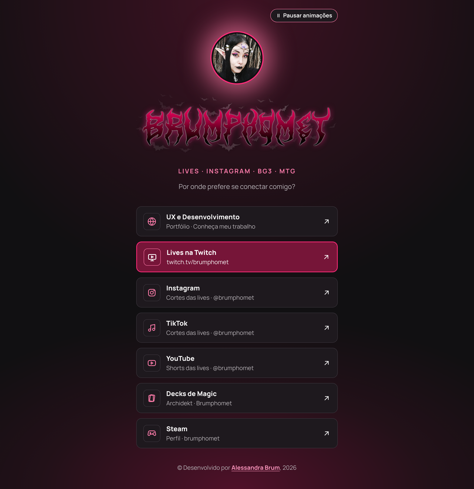
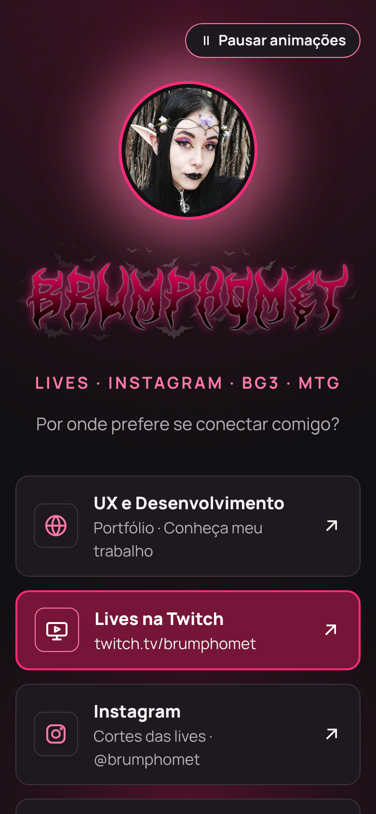

# Brumphomet Lives · Links

Página de links do **Brumphomet**, canal de lives de *Baldur's Gate 3* e conteúdo de jogos como *Magic: The Gathering* na Twitch. Reúne em um só lugar o portfólio, as lives, os cortes nas redes sociais, os decks de Magic e o perfil na Steam.

🔗 **Acesse:** [brumpholinks.alessandrabrum.com](https://brumpholinks.alessandrabrum.com/) para conferir o deploy.

## Pré-visualização

| Desktop | Celular |
| :---: | :---: |
|  |  |

## Tecnologias

- HTML5 semântico
- CSS3 (mobile first, variáveis CSS)
- JavaScript puro, sem bibliotecas
- Fonte [Manrope](https://fonts.google.com/specimen/Manrope) (Google Fonts)

## Acessibilidade

- Botão para **pausar e retomar as animações**, com a escolha salva no navegador
- Respeita a configuração do sistema operacional de **reduzir movimento** (`prefers-reduced-motion`): quando ativa, as animações ficam desligadas
- Link "Pular para os links" para quem navega pelo teclado
- Navegação completa por teclado, com foco visível
- Textos alternativos nas imagens e ícones decorativos ocultos para leitores de tela
- Aviso "(abre em nova aba)" nos links externos, para leitores de tela
- Cores com alto contraste

## Licença

Distribuído sob a licença MIT. Veja o arquivo [LICENSE](LICENSE).

---

Desenvolvido por [Alessandra Brum](https://links.alessandrabrum.com).
